# Sebastián Macías

Desarrollo aplicaciones y herramientas para diseño, producción y trabajo con gráficos vectoriales. Me interesa que la interfaz sea clara y que el motor haga bien su trabajo.

[Portafolio](https://portafolio-web-eta-six.vercel.app/) · [Repositorios](https://github.com/Tomoya0k?tab=repositories)

## Proyectos públicos

<table>
  <tr>
    <td width="50%"><a href="https://github.com/Tomoya0k/SkNesting">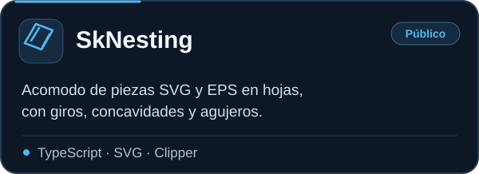</a></td>
    <td width="50%"><a href="https://github.com/Tomoya0k/SkLed">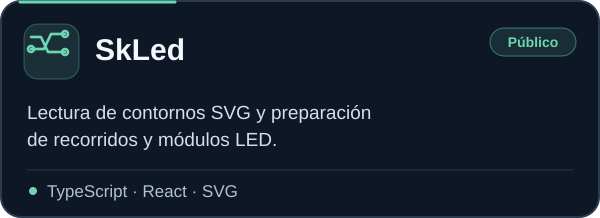</a></td>
  </tr>
</table>

<a href="https://github.com/Tomoya0k/Tomoya0k">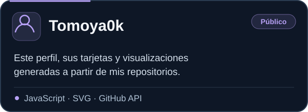</a>

## Proyectos privados

El código de estos proyectos requiere acceso al repositorio. Las tarjetas muestran su propósito y las tecnologías principales.

<table>
  <tr>
    <td width="50%"><a href="https://github.com/Tomoya0k/Gimnexa">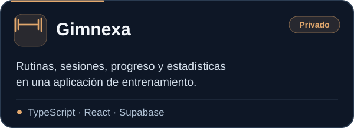</a></td>
    <td width="50%"><a href="https://github.com/Tomoya0k/Digital.A">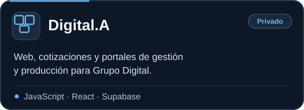</a></td>
  </tr>
  <tr>
    <td width="50%"><a href="https://github.com/Tomoya0k/OZPA">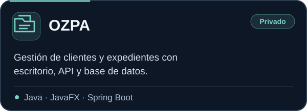</a></td>
    <td width="50%"><a href="https://github.com/Tomoya0k/portafolio-web">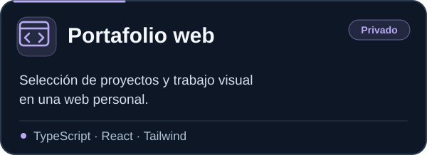</a></td>
  </tr>
</table>

<a href="https://github.com/Tomoya0k/foodgate-sushi-menu">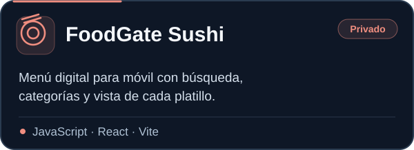</a>

## Código abierto

Forks públicos en los que exploro herramientas y arquitecturas distintas.

<table>
  <tr>
    <td width="50%"><a href="https://github.com/Tomoya0k/Open-Stellar">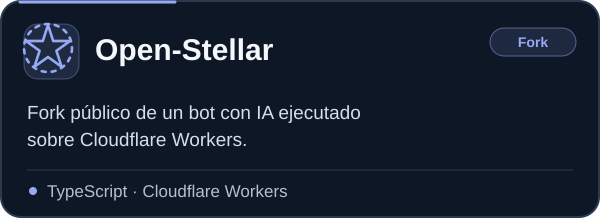</a></td>
    <td width="50%"><a href="https://github.com/Tomoya0k/StellarGate">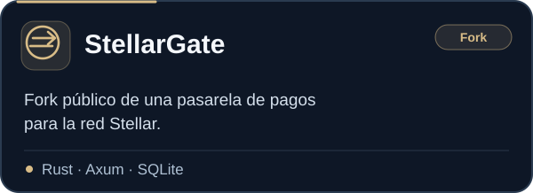</a></td>
  </tr>
</table>

## Tecnologías


Los porcentajes corresponden a los bytes por lenguaje que reporta [GitHub Linguist](https://github.com/github-linguist/linguist) en siete proyectos propios y dos forks públicos, consultados el **12 de octubre de 2026**. El repositorio de este perfil no entra en el cálculo. Los iconos de tecnologías provienen de [Simple Icons](https://simpleicons.org/). Para actualizar los datos y las imágenes: `node scripts/build-profile.mjs --refresh`.
